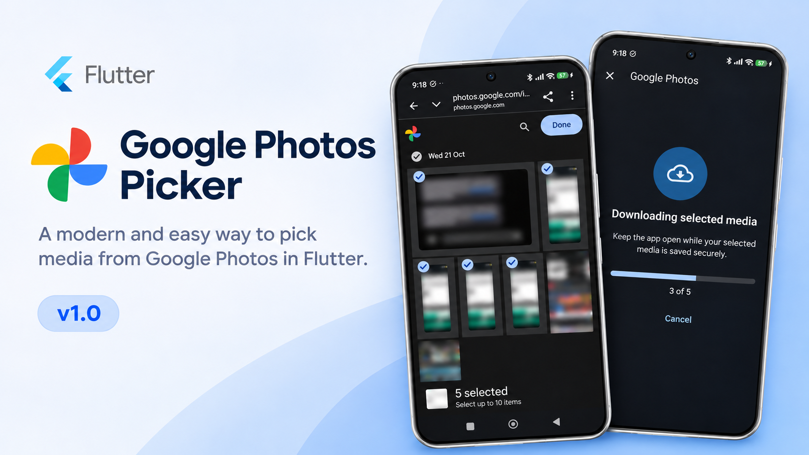
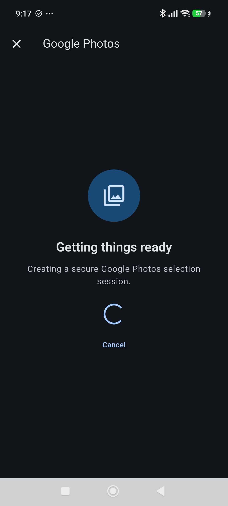
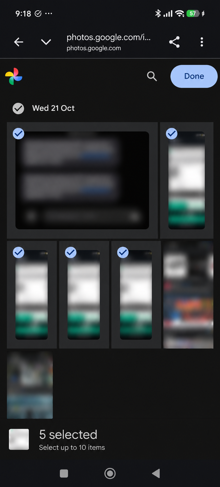
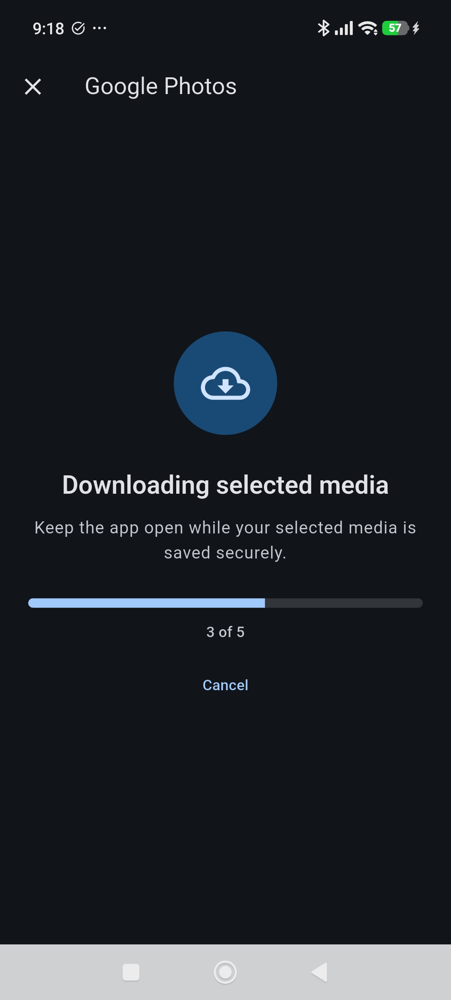
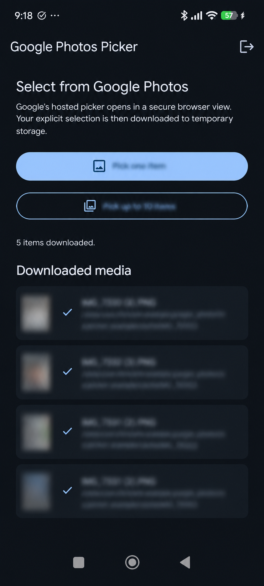

# Google Photos Picker



`google_photos_picker` is a Flutter picker for selecting and downloading photos
and videos through the official Google Photos Picker API.

The package uses Google Sign-In 7 and OAuth directly. It does not require
Firebase Authentication, a Google API key, or access to the user's complete
Photos library.

## Features

- Least-privilege Google Photos Picker OAuth authorization
- Google-hosted photo and video selection in a managed in-app browser view
- Automatic picker dismissal on Android and iOS when selection is complete
- Trigger-defined single or multiple selection with a maximum count
- API-recommended polling intervals and session timeouts
- Paginated selected-media retrieval
- Authenticated photo and video downloads
- Sanitized, collision-safe filenames in temporary storage
- Loading, retry, cancellation, and error states
- Typed models and service errors
- Proactive picking-session and HTTP client cleanup
- Host light/dark theme inheritance

## Preview

<table>
  <tr>
    <td align="center" width="50%">
      
      <br />
      <sub>Secure session preparation</sub>
    </td>
    <td align="center" width="50%">
      
      <br />
      <sub>Google-hosted media selection</sub>
    </td>
  </tr>
  <tr>
    <td align="center" width="50%">
      
      <br />
      <sub>Automatic return and download progress</sub>
    </td>
    <td align="center" width="50%">
      
      <br />
      <sub>Downloaded media ready for the app</sub>
    </td>
  </tr>
</table>

## Requirements

| Requirement | Minimum |
|---|---:|
| Flutter | 3.29 |
| Dart | 3.7 |
| Android | SDK 24 |
| iOS | 15.0 |
| macOS | 12.0 |

The current API returns a `dart:io` `File`; web is not supported.

## Install

```yaml
dependencies:
  google_photos_picker: ^0.1.0
```

Then run:

```sh
flutter pub get
```

## Values you need

Create these values in the
[Google Cloud console](https://console.cloud.google.com/). OAuth client IDs are
public identifiers, not secrets.

| Target | Create in Google Auth Platform | Used by the app |
|---|---|---|
| Android | Android OAuth client | Registered remotely; not pasted into Dart |
| Android sign-in | Web application OAuth client | `serverClientId` / `GOOGLE_SERVER_CLIENT_ID` |
| iOS | iOS OAuth client | `clientId` / `GIDClientID` |
| iOS callback | Reversed iOS client ID | `CFBundleURLTypes` URL scheme |
| macOS | iOS OAuth client using the macOS bundle ID | Same client-ID and URL-scheme setup as iOS |

You do **not** need:

- A Google API key
- A service-account key
- Firebase Authentication
- An OAuth client secret inside the Flutter application

Never embed a web OAuth client secret, service-account JSON, access token,
refresh token, or signing private key in the app or repository.

## Google Cloud setup

### 1. Create or select a project

Open the [Google Cloud project selector](https://console.cloud.google.com/projectselector2/home/dashboard)
and create or select the project that will own the OAuth configuration.

Use separate development and production Cloud projects when you need isolated
test users, consent settings, quotas, or credentials.

### 2. Enable the Google Photos Picker API

Open **APIs & Services → Library**, search for **Google Photos Picker API**,
open it, and select **Enable**.

Direct page: [Google Photos Picker API](https://console.cloud.google.com/apis/library/photospicker.googleapis.com)

Do not enable the similarly named **Google Picker API** by mistake. It is a
different API.

### 3. Configure Google Auth Platform

Open [Google Auth Platform](https://console.cloud.google.com/auth/overview) for
the selected project and complete:

1. **Branding** — set the application name, support email, logo/domain details,
   homepage, privacy policy, terms, and developer contact email as applicable.
2. **Audience** — choose **Internal** for a supported Google Workspace
   organization-only app, or **External** for other Google accounts.
3. **Audience → Test users** — while publishing status is **Testing**, add every
   Google account that should be allowed to sign in.
4. **Data Access → Add or remove scopes** — add:

```text
https://www.googleapis.com/auth/photospicker.mediaitems.readonly
```

This is the only scope requested by the package. It permits creating picker
sessions and retrieving only the photos and videos the user explicitly selects.
It does not grant general read access to the user's library.

Before a public release, complete the OAuth verification required for Google
Photos API access and review the current
[Photos API User Data Policy](https://developers.google.com/photos/support/api-policy).

### 4. Create OAuth clients

Open **Google Auth Platform → Clients**, select **Create client**, and create
the platform clients described below.

Direct page: [OAuth clients](https://console.cloud.google.com/auth/clients)

Keep production client IDs stable. Active Google Photos resources are tied to
the client ID that created them.

## Android configuration

### Find the application ID

For the included example it is:

```text
com.example.google_photos_picker_example
```

For another app, read `applicationId` from
`android/app/build.gradle` or `android/app/build.gradle.kts`. Use the exact
value for the build variant being tested.

### Set the minimum Android SDK

The current Google Sign-In dependency requires Android SDK 24 or newer:

```kotlin
android {
    defaultConfig {
        minSdk = 24
    }
}
```

### Generate signing fingerprints

From the Flutter application's `android` directory run:

```sh
./gradlew signingReport
```

On Windows use:

```powershell
.\gradlew signingReport
```

Under the intended variant, copy its **SHA-1** fingerprint. Register debug,
release, and flavor-specific signing certificates separately when they differ.
For a Play-distributed build using Play App Signing, also register the app
signing certificate shown under **Play Console → Setup → App integrity**; it can
differ from the upload certificate.

### Create the Android OAuth client

In **Google Auth Platform → Clients → Create client**:

1. Select **Android**.
2. Enter a recognizable name.
3. Enter the exact Android package/application ID.
4. Enter the matching SHA-1 fingerprint.
5. Create the client.

Repeat for any package-name/signing-certificate combination not covered by the
first client.

### Create the Web OAuth client used by Android

Create another client with application type **Web application**. Copy its
client ID, which looks like:

```text
123456789012-abcdefghijklmnopqrstuvwxyz.apps.googleusercontent.com
```

Only the client ID is used. Do not put the generated client secret in Flutter.

Pass that web client ID to the example:

```sh
cd example
flutter run \
  --dart-define=GOOGLE_SERVER_CLIENT_ID=YOUR_WEB_OAUTH_CLIENT_ID
```

Alternatively, Android can obtain the web client ID through a properly
configured `google-services.json` and Google Services Gradle integration. That
route does not require Firebase Authentication, but it does require the normal
Google Services setup. The `--dart-define` route is the smallest setup for the
example.

The example's generated Android project uses debug signing for local
release-mode runs. Configure a real release signing key before distributing an
application.

## iOS configuration

### Find the bundle identifier

For the included example it is:

```text
com.example.googlePhotosPickerExample
```

For another app, open `ios/Runner.xcodeproj` in Xcode and inspect
**Runner target → Signing & Capabilities → Bundle Identifier**, or inspect
`PRODUCT_BUNDLE_IDENTIFIER` in the Xcode project.

Set the deployment target to iOS 15.0 or newer.

### Create the iOS OAuth client

In **Google Auth Platform → Clients → Create client**:

1. Select **iOS**.
2. Enter a recognizable name.
3. Enter the exact bundle identifier.
4. Create the client.
5. Copy the normal client ID and the displayed **iOS URL scheme**. You can also
   download the configuration plist and read `CLIENT_ID` and
   `REVERSED_CLIENT_ID`.

Example normal client ID:

```text
123456789012-abcdefghijklmnopqrstuvwxyz.apps.googleusercontent.com
```

Corresponding reversed client ID / URL scheme:

```text
com.googleusercontent.apps.123456789012-abcdefghijklmnopqrstuvwxyz
```

### Add the URL scheme

Add the reversed OAuth client ID as a URL scheme in `Info.plist`:

```xml
<key>CFBundleURLTypes</key>
<array>
  <dict>
    <key>CFBundleTypeRole</key>
    <string>Editor</string>
    <key>CFBundleURLSchemes</key>
    <array>
      <string>YOUR_REVERSED_CLIENT_ID</string>
    </array>
  </dict>
</array>
```

### Supply the normal iOS client ID

Choose either configuration method.

Method A — pass it when running the example:

```sh
cd example
flutter run \
  --dart-define=GOOGLE_CLIENT_ID=YOUR_IOS_OAUTH_CLIENT_ID
```

Method B — add it to `ios/Runner/Info.plist`:

```xml
<key>GIDClientID</key>
<string>YOUR_IOS_OAUTH_CLIENT_ID</string>
```

Then initialize without an explicit `clientId`. The reversed URL scheme is
required for both methods so Google can return to the application after
authentication.

## macOS configuration

Set the deployment target to macOS 12.0 or newer. Create an **iOS** OAuth client
using the exact macOS bundle identifier, then apply the same `GIDClientID` and
reversed URL scheme configuration to `macos/Runner/Info.plist`.

Google Sign-In on macOS also requires Keychain access, and sandboxed builds need
outbound network access. Add these values to both `DebugProfile.entitlements`
and `Release.entitlements`:

```xml
<key>com.apple.security.network.client</key>
<true/>
<key>keychain-access-groups</key>
<array>
  <string>$(AppIdentifierPrefix)$(CFBundleIdentifier)</string>
</array>
```

The application must be signed with an Apple-issued certificate so credentials
can be stored in Keychain.

## Run the included example

Install packages:

```sh
flutter pub get
cd example
flutter pub get
```

List available devices:

```sh
flutter devices
```

Run Android:

```sh
flutter run \
  -d YOUR_ANDROID_DEVICE_ID \
  --dart-define=GOOGLE_SERVER_CLIENT_ID=YOUR_WEB_OAUTH_CLIENT_ID
```

Run iOS or macOS:

```sh
flutter run \
  -d YOUR_APPLE_DEVICE_ID \
  --dart-define=GOOGLE_CLIENT_ID=YOUR_IOS_OAUTH_CLIENT_ID
```

If identifiers are already supplied through native configuration, omit their
corresponding `--dart-define` arguments. Client IDs are public, but never use
`--dart-define` for client secrets or access tokens.

## Usage

Initialize once before `runApp`. Platform configuration can provide the client
identifiers, so both arguments are optional:

```dart
import 'dart:io';

import 'package:flutter/material.dart';
import 'package:google_photos_picker/google_photos_picker.dart';

Future<void> main() async {
  WidgetsFlutterBinding.ensureInitialized();

  await GooglePhotosPicker.instance.initialize(
    clientId: optionalIosOrMacosClientId,
    serverClientId: optionalAndroidWebClientId,
  );

  runApp(const MyApp());
}
```

When supporting both Android and Apple platforms from one codebase, only pass
the Apple client ID on iOS/macOS:

```dart
await GooglePhotosPicker.instance.initialize(
  clientId: (Platform.isIOS || Platform.isMacOS) ? appleClientId : null,
  serverClientId: Platform.isAndroid ? androidWebClientId : null,
);
```

The included example performs this platform check automatically for its
compile-time client ID values.

Open the picker from a user interaction:

```dart
final File? file = await GooglePhotosPicker.instance.pickFile(
  context: context,
);

if (file != null) {
  // Inspect it, upload it, or copy it to permanent application storage.
  debugPrint(file.path);
}
```

### Configure each picker trigger

The caller controls the selection limit for every invocation. Use `pickFile`
for one result, `pickFiles` for multiple results, or `pick` with a
`GooglePhotosPickerOptions` object when the configuration is chosen at runtime.

Allow up to ten selected photos or videos:

```dart
final List<File>? media = await GooglePhotosPicker.instance.pickFiles(
  context: context,
  maxItems: 10,
);

if (media != null) {
  for (final File file in media) {
    debugPrint(file.path);
  }
}
```

For a selection limit chosen at runtime, use `pick(...)`. It always returns
`List<File>?`:

```dart
final List<File>? media = await GooglePhotosPicker.instance.pick(
  context: context,
  options: GooglePhotosPickerOptions(maxItems: selectionLimit),
);
```

`maxItems` must be between 1 and 2,000. When omitted, Google allows up to 2,000
items. The public Picker API does not currently provide MIME-type, extension,
photo-only, or video-only session filters.

Do not start simultaneous picker calls. Keep one authentication, navigation,
and picking session active at a time.

Sign out when your application needs to end the Google session:

```dart
await GooglePhotosPicker.instance.signOut();
```

## File lifecycle

Returned files are written to the platform temporary directory. The operating
system may delete them at any time. Copy them to application documents or other
permanent storage if they must survive cache cleanup.

The package creates a collision-safe filename instead of replacing an existing
temporary file with the same name. Large videos and large selections can use
significant network bandwidth and temporary disk space. Downloads are performed
sequentially.

## Errors and cancellation

- Cancelling Google Sign-In or closing the picker returns `null`.
- A completed session with no selected media returns an empty list.
- `pickFile` returns `File?`; `pickFiles` and `pick` return `List<File>?`.
- `GooglePhotosAuthorizationException` indicates that Photos authorization was
  not available.
- Google Photos API, picker-launch, timeout, and download failures are displayed
  in the picker screen with a retry action.
- The lower-level `GooglePhotosApiService` throws `GooglePhotosApiException`
  with an HTTP status code when one is available.
- Other Google Sign-In failures can propagate before the picker screen opens.

Wrap picker calls in `try`/`catch` and present an appropriate retry action for
authentication failures.

## Important API behavior

- The picker interface is hosted by Google Photos and opens outside the Flutter
  application. It cannot be restyled or embedded in an iframe.
- The package can retrieve only media explicitly selected for the current
  session; it cannot browse the complete library.
- Google Photos download URLs are short-lived and require OAuth authorization.
  The package downloads selected bytes before deleting the session.
- A video that is still processing in Google Photos cannot be downloaded until
  its processing status becomes `READY`.

## Official configuration references

- [Configure a Google Photos API app](https://developers.google.com/photos/overview/configure-your-app)
- [Google Photos Picker API](https://developers.google.com/photos/picker/guides/get-started-picker)
- [Create and manage picking sessions](https://developers.google.com/photos/picker/guides/sessions)
- [List and retrieve selected media](https://developers.google.com/photos/picker/guides/media-items)
- [Google Photos authorization scopes](https://developers.google.com/photos/overview/authorization)
- [Google Photos API limits and quotas](https://developers.google.com/photos/overview/api-limits-quotas)
- [Google Sign-In for Android](https://pub.dev/packages/google_sign_in_android#integration)
- [Google Sign-In for iOS and macOS](https://pub.dev/packages/google_sign_in_ios#ios-integration)

## Support

- [Complete example](example/README.md)
- [Changelog](CHANGELOG.md)
- [Issue tracker](https://github.com/WorkWithAfridi/google_photos_picker/issues)
